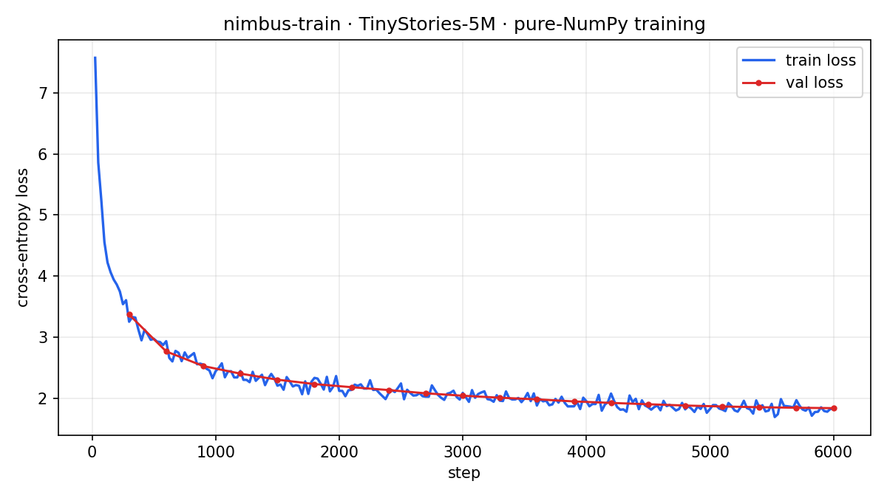

<div align="center">

# nimbus-train

**Train a transformer from scratch in pure NumPy — including the backprop.**

No PyTorch. No autograd. No framework. NumPy is the *only* dependency.
Every gradient in this repo is derived by hand, verified against finite
differences, and cross-checked against PyTorch autograd to 1e-9.

Trained models export straight into
[nimbus-infer](https://github.com/EAnge1o/nimbus-infer) for KV-cache and
int8-quantized inference: **train it here, run it there.**

[](https://github.com/EAnge1o/nimbus-train/actions/workflows/ci.yml)


</div>

---

## Why

nanoGPT proves you can shrink *training code* to a few hundred lines — but it
still leans on PyTorch's autograd engine for the hardest part: the backward
pass. **nimbus-train removes that crutch.** Every layer's vector-Jacobian
product — LayerNorm's three-term gradient, the softmax Jacobian collapse,
RoPE's inverse rotation, GQA's repeat-and-sum — is written out by hand, with
the derivation documented in
[docs/ARCHITECTURE.md](docs/ARCHITECTURE.md) and machine-checked in CI.

It is the training half of the nimbus story:

```
nimbus-train                        nimbus-infer
────────────                        ────────────
train tokenizer                     │
    │                               │
pretrain (hand-written backprop)    │
    │                               │
SFT / LoRA / DPO                    │
    │      export ─────────────────► load checkpoint
    │                               │
    └─ fp32 on your CPU             ├─ KV-cache generation
                                    ├─ int8 quantization (≈4× smaller)
                                    └─ chat REPL / OpenAI-compatible server
```

## Results — a 4.9M-parameter model trained on a laptop CPU

Trained on **TinyStoriesV2-GPT4** (100 MB slice → 25.2M tokens) with a
from-scratch 8,192-token BPE tokenizer, on an i7-12700H laptop, CPU only,
pure NumPy: **6,000 steps ≈ 49M tokens in 6.4 hours** at **~2,330 tokens/s
sustained** (hand-optimized elementwise kernels + BLAS, see below).

Final loss **1.825** (val 1.838, perplexity ≈ 6.3) — full metrics, samples
and demo logs in [results/FLAGSHIP.md](results/FLAGSHIP.md):



What the exported model writes through **nimbus-infer** (temperature 0.8):

```text
> Once upon a time
, there was a wealthy man named Jack. He lived in a small house with many
old clothes. Jack liked to play with his toys and find his favorite toy,
a big bow. One day, Jack wanted to show his friend the bow to his friend,
Sam. He ran to Sam's house and jumped in. "Look, Sam! I found a bow!" ...

> One sunny day, Lily
found a pretty pink flower that she wanted to show her mom. "Look, Mom! I
found a bright red flower!" Lily said. Her mom looked at the flower and
smiled. "That's a very pretty flower, Lily. Let's show it back it!" ...
```

**Fine-tuning demos on the same checkpoint** (both LoRA, r=8, 1.3% trainable):

* **SFT** — first-sentence → story completion, loss on completion tokens
  only: completion loss 2.12 → **1.73** in 300 steps (~7 min on CPU).
* **DPO** — real vs swapped continuations, β=0.1, frozen base as reference
  policy: preference accuracy 50% → **90–100%**, loss from its theoretical
  starting point ln 2 → ~0.15.

**The closed loop, run for real:**

```text
$ python -m nimbus_train export --run runs/tinystories-5m --out checkpoints/tinystories-5m
exported 4,854,272 params -> checkpoints/tinystories-5m
verified: max logit diff 0.00e+00        # bit-exact roundtrip

$ python -m nimbus_infer chat checkpoints/tinystories-5m   # ← the OTHER repo
, there was a wealthy man named Jack. He lived in a small house ...
```

and int8-quantized, still in nimbus-infer: **3.96× smaller (19.4 → 4.9 MB),
same story voice.**

## Quickstart

```bash
pip install numpy            # that's the whole dependency list
```

```bash
# 1. train a byte-level BPE tokenizer (GPT-2 file format)
python -m nimbus_train train-tokenizer --text data/corpus.txt \
    --vocab-size 8192 --out data/tokenizer

# 2. encode the corpus into memory-mapped token bins
python -m nimbus_train prepare-data --text data/corpus.txt \
    --tokenizer data/tokenizer --val-frac 0.01 --out data

# 3. pretrain (resumes automatically if the run dir exists)
python -m nimbus_train pretrain --data data --out runs/mymodel \
    --layers 4 --heads 8 --d-model 256 --seq 256 --batch 32 \
    --steps 6000 --lr 2.5e-3

# 4. fine-tune — LoRA (frozen base, ~2% trainable params) or full
python -m nimbus_train sft --run runs/mymodel --data sft.jsonl \
    --out runs/mymodel-sft --mode lora --lora-r 8

# 5. align preferences — DPO against the frozen base as reference policy
python -m nimbus_train dpo --run runs/mymodel --data pairs.jsonl \
    --out runs/mymodel-dpo --mode lora --beta 0.1

# 6. export and hand off to nimbus-infer
python -m nimbus_train export --run runs/mymodel --out checkpoints/mymodel
python -m nimbus_infer chat checkpoints/mymodel
```

No `nimbus_infer` installed? Step 4.5 generates inside this repo:

```bash
python -m nimbus_train generate --checkpoint checkpoints/mymodel \
    --prompt "Once upon a time" --temperature 0.8
```

## What's inside

| | |
|---|---|
| **Hand-written backward** | linear, LayerNorm, RMSNorm, GELU(tanh), SiLU, softmax+CE (fused), causal attention, GQA, RoPE, embeddings, weight tying — all derived in [docs/ARCHITECTURE.md](docs/ARCHITECTURE.md) |
| **Two architecture families** | GPT-2 style (learned pos, LayerNorm, GELU) and LLaMA style (RoPE, RMSNorm, SwiGLU, GQA) — same code path, both gradcheck-clean |
| **nimbus-infer compatibility** | identical parameter naming, `(in, out)` layout and `config.json` schema; exports a hand-parsed, hand-written `.safetensors` |
| **Training stack** | AdamW (decoupled WD), cosine schedule with warmup, global-norm clipping, memmapped token bins, checkpoint/resume, CSV logs |
| **Fine-tuning** | SFT with completion-only loss masking; LoRA adapters (no-op at init, frozen-weight gradient matmuls *skipped*, mergeable); DPO with hand-derived logits gradient |
| **Verification** | finite differences (float64) per op + full model; PyTorch autograd parity at 1e-9; export roundtrip bit-exactness; tamper detection |
| **CPU engineering** | threaded elementwise fan-out (GIL-releasing ufuncs), in-place softmax/CE, cached causal masks — **3.2×** faster steps |

## Verification highlights

```text
tests/test_gradcheck.py      4 architectures × ~500 params each:
                             finite-difference vs hand-written backward, 0 fails
tests/test_torch_parity.py   same weights through torch.autograd:
                             max relative gradient error < 1e-9
tests/test_lora.py           adapters are bit-identical no-ops at init;
                             train_only grads == full grads; merge == adapters
tests/test_dpo.py            DPO loss + logits gradient vs finite differences
tests/test_export.py         safetensors roundtrip bit-exact; tamper detection
tests/test_cli.py            tokenizer → data → pretrain → sft → dpo → export
                             → generate, through the real CLI
```

```bash
pip install pytest && pytest -q          # 73 tests, ~10 s, numpy only
pip install torch && pytest tests/test_torch_parity.py   # optional cross-check
```

## Repo layout

```
nimbus_train/
  ops.py         every primitive, forward + hand-derived backward
  model.py       GPT-2 & LLaMA families: init / forward / exact backward
  config.py      ModelConfig — schema-compatible with nimbus-infer
  optimizer.py   AdamW + cosine schedule + grad clipping
  tokenizer.py   byte-level BPE: incremental trainer, GPT-2 file format
  data.py        token bins, batch sampler, SFT masking
  trainer.py     pretraining loop: checkpoint / resume / CSV log
  lora.py        adapter attach / save / load / merge
  sft.py         supervised fine-tune (full or LoRA)
  dpo.py         direct preference optimization
  sampler.py     temperature / top-k / top-p sampling
  export.py      safetensors writer + verified nimbus-infer export
  cli.py         the eight subcommands above
tests/           73 tests, ~10 s, no GPU, no torch required
docs/ARCHITECTURE.md   the backward derivations, op by op
```

## Honest limitations

* CPU NumPy training tops out around ~2–8M parameters per overnight run;
  the flagship model here is deliberately compute-optimal, not frontier.
* Sampling in this repo re-runs the full sequence per token — efficient
  KV-cache decoding is nimbus-infer's job, by design.
* LoRA dropout is not implemented (adapters are deterministic).
* DPO is validated on synthetic preference pairs and small models; it is a
  correct implementation of the algorithm, not a scaled RLHF pipeline.

## License

MIT — same as nimbus-infer. Built as the training half of the
[nimbus](https://github.com/EAnge1o) from-scratch series:
inference engine ([nimbus-infer](https://github.com/EAnge1o/nimbus-infer)),
Rust port ([nimbus-infer-rs](https://github.com/EAnge1o/nimbus-infer-rs)),
and now the trainer.
